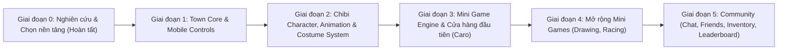

# Lộ Trình Phát Triển (Development Roadmap): MINI WORLD PARTY

> **Nền tảng khởi đầu:** Khởi tạo từ bộ khung **[Gather Clone (`cc26-sudo/Gather`)](https://github.com/cc26-sudo/Gather)**, nâng cấp lên TypeScript và kiến trúc Plugin theo thiết kế trong `technical_architecture.md`.

---

## Tổng Quan Các Giai Đoạn

---

## Chi Tiết Từng Giai Đoạn & Tiêu Chí Nghiệm Thu (Verification Gates)

### Giai đoạn 0: Nghiên cứu Nền tảng & Kiểm thử Thực nghiệm ✅ *(Đã hoàn thành)*
* **Hạng mục đã thực hiện:**
  * Phân tích mã nguồn và kiểm tra giấy phép code/assets của `cc26-sudo/Gather` (MIT/ISC, 100% Procedural Canvas) và `PhatBanhGH/TheGathering` (ISC code, LPC CC-BY-SA/GPL assets).
  * Chạy thử thực tế server + client và kiểm thử 2 người chơi online đồng thời trên Desktop (`1280x720`) và Mobile (`393x852`).
  * Bàn giao 3 tài liệu thiết kế nền tảng.

---

### Giai đoạn 1: Xây dựng `Game Core` — Bản đồ Thị trấn 2D & Điều khiển Đa thiết bị
* **Mục tiêu:** Chuyển đổi văn phòng `24x18` của Gather Clone thành **Bản đồ Thị trấn 2D (Town Map)** có Quảng trường trung tâm, Đường phố, và các Cửa hàng; lược bỏ phần ép buộc bật Camera/Mic WebRTC lúc đăng nhập; bổ sung điều khiển cảm ứng cho điện thoại.
* **Công việc cụ thể:**
  1. Tắt màn hình `MediaTest` bắt buộc trong `LoginScreen` để vào thẳng thị trấn trong 1 bước nhập tên.
  2. Thay `OfficeScene` bằng `TownScene` hỗ trợ bản đồ lớn (VD: `48x36` hoặc `64x48` ô) gồm Quảng trường, Đường phố, Ghế đá công viên và 3–4 mặt tiền Cửa hàng (Caro Shop, Drawing Studio, Racing Arcade).
  3. Xây dựng `ShopTriggerZone` trước cửa mỗi cửa hàng: khi nhân vật đi vào vùng cửa hàng, hiển thị nút tương tác **"Vào Cửa Hàng"** (hỗ trợ cả phím `E` trên PC và nút chạm trên Mobile).
  4. Xây dựng `MobileInputController`: Cần gạt ảo (Virtual Joystick) góc dưới trái + nút Nhảy/Tương tác góc dưới phải + Pinch-to-zoom.
* **Tiêu chí nghiệm thu (`Verify`):**
  * `[Verify 1.1]` Mở 2 trình duyệt (1 Desktop + 1 giả lập Mobile iPhone), đăng nhập không bị hỏi quyền Camera/Mic, cả 2 nhìn thấy nhau di chuyển mượt tại Quảng trường.
  * `[Verify 1.2]` Dùng cảm ứng kéo Virtual Joystick trên Mobile đi bộ tới trước cửa hàng, nút "Vào Cửa Hàng" bật sáng và bấm được bằng tay.

---

### Giai đoạn 2: Hệ thống Nhân vật Chibi 2D, 6 Animation & Trang phục Theo Lớp
* **Mục tiêu:** Thay thế sprite 4 frame tĩnh hiện tại bằng hệ thống **Chibi 2D nét mượt** hỗ trợ đủ 6 động tác (`idle`, `walk`, `run`, `jump`, `sit`, `wave`) và hệ thống ghép lớp trang phục (`toc`, `ao`, `quan`, `giay`, `phu_kien`) đọc hoàn toàn từ file cấu hình JSON.
* **Công việc cụ thể:**
  1. Xây dựng `CostumeComposer` (kế thừa ý tưởng Offscreen Canvas từ `TheGathering` nhưng dùng nghệ thuật Chibi nét mượt tự chủ bản quyền) để ghép các lớp `body`, `shoes`, `bottom`, `top`, `hair`, `accessory` thành spritesheet cache theo mã hash.
  2. Xây dựng `AnimationSystem` tự động đăng ký 6 trạng thái hoạt ảnh:
     * `idle`: Đứng thở nhấp nhô nhẹ.
     * `walk`: Đi bộ.
     * `run`: Chạy lon ton (khi giữ `Shift` hoặc kéo căng Joystick).
     * `jump`: Nhảy lên (phím `Space` hoặc nút Jump cảm ứng) với hiệu ứng bóng đổ thu nhỏ dưới đất.
     * `sit`: Ngồi xuống khi đứng cạnh ghế công viên/thảm quảng trường hoặc bấm nút Ngồi.
     * `wave`: Vẫy tay chào đồng bộ qua Socket.IO tới mọi người xung quanh.
  3. Xây dựng giao diện **Tủ đồ (Wardrobe / Costume Editor Modal)** cho phép đổi tóc, áo, quần, giày, phụ kiện ngay trong thị trấn và đồng bộ tức thì (`player:costume-updated`) cho người chơi khác thấy.
* **Tiêu chí nghiệm thu (`Verify`):**
  * `[Verify 2.1]` Người chơi A đổi áo/tóc/mũ trong Tủ đồ -> màn hình Người chơi B thấy nhân vật A đổi trang phục ngay lập tức mà không cần tải lại trang.
  * `[Verify 2.2]` Thực hiện đủ 6 động tác (`idle`, `walk`, `run`, `jump`, `sit`, `wave`) -> mọi lớp trang phục (tóc, áo, quần, giày, phụ kiện) khớp hoàn toàn theo từng frame, không bị lệch pixel.
  * `[Verify 2.3]` Thử thêm 1 chiếc mũ mới và 1 animation mới vào `costume-manifest.json` / `animation-manifest.json` mà **không sửa 1 dòng code nào** trong `CharacterSystem` -> vật phẩm hiển thị trong tủ đồ và mặc được ngay.

---

### Giai đoạn 3: `Mini Game Engine` (Plugin System, Room 2–4 người) & Mini Game #1 (`Caro`)
* **Mục tiêu:** Xây dựng lõi `Mini Game Engine` tách rời hoàn toàn khỏi `Game Core` và kiểm chứng bằng việc cắm module mini-game đầu tiên: **Cờ Caro (2 người)**.
* **Công việc cụ thể:**
  1. Xây dựng `GameRegistry` (Server & Client), `RoomManager` (tạo phòng, danh sách phòng tại cửa hàng, tham gia phòng, trạng thái `Ready`, giới hạn 2–4 người) và `GameLifecycle` (`waiting` -> `playing` -> `ended`).
  2. Xây dựng `ShopLobbyModal.tsx`: Khi bấm "Vào Cửa Hàng", hiển thị danh sách bàn chờ của cửa hàng đó, nút "Tạo Phòng Mới", "Ghép Nhanh (Quick Match)" và nút "Sẵn Sàng".
  3. Phát triển module độc lập `mini-games/caro/` (`CaroServerPlugin` + `CaroClientModule`): bàn cờ 15×15, đếm ngược lượt đi, kiểm tra thắng 5 quân liên tiếp, trao điểm khi kết thúc ván.
* **Tiêu chí nghiệm thu (`Verify`):**
  * `[Verify 3.1]` 2 người chơi đi tới cửa hàng Caro, tạo phòng, bấm Sẵn sàng -> ván cờ Caro bắt đầu, đánh thắng/thua chuẩn xác, kết thúc ván trả người chơi về lại cửa hàng trong thị trấn.
  * `[Verify 3.2]` Người chơi thứ 3 đang đi dạo ngoài thị trấn thấy biểu tượng `🎮 Đang chơi Caro` trên đầu 2 người kia và không bị ảnh hưởng bởi các gói tin nước cờ bên trong phòng Caro.

---

### Giai đoạn 4: Mở rộng Các Module Mini Game Độc lập (`Drawing Game`, `Racing Game`)
* **Mục tiêu:** Chứng minh khả năng mở rộng của kiến trúc Plugin bằng cách thêm 2 thể loại mini-game hoàn toàn khác nhau (1 game vẽ đoán chữ theo lượt 2–4 người và 1 game đua tốc độ thời gian thực 2–4 người) mà **không sửa đổi `Game Core` hay `Mini Game Engine`**.
* **Công việc cụ thể:**
  1. Module `mini-games/drawing/` (2–4 người): 1 người vẽ trên bảng Canvas đồng bộ nét vẽ real-time, 3 người còn lại đoán từ khóa để tính điểm.
  2. Module `mini-games/racing/` (2–4 người): Đua chạy nước rút / vượt chướng ngại vật sử dụng vòng lặp `onTick` của `IMiniGameServerPlugin`.
  3. Đặt 2 cửa hàng tương ứng lên bản đồ Thị trấn và đăng ký vào `GameRegistry`.
* **Tiêu chí nghiệm thu (`Verify`):**
  * `[Verify 4.1]` `git diff client/src/core server/src/core` bằng **0** khi thêm cả 2 mini-game mới.
  * `[Verify 4.2]` 4 người chơi vào phòng Drawing Game và Racing Game chơi trọn vẹn từ lúc Ready đến bảng tổng kết điểm.

---

### Giai đoạn 5: Hệ thống Cộng đồng (`Community`: Chat, Friends, Inventory, Leaderboard)
* **Mục tiêu:** Hoàn thiện vòng lặp gắn kết người chơi trong thị trấn.
* **Công việc cụ thể:**
  1. **Chat:** Khung chat góc dưới (Chat toàn thị trấn + Bong bóng chat bay lên trên đầu nhân vật trong tầm nhìn).
  2. **Leaderboard & Xu thưởng (Coins):** Điểm thắng từ các mini-game được cộng vào bảng xếp hạng thị trấn và quy đổi thành Xu.
  3. **Shop Trang phục & Inventory:** Dùng Xu thắng mini-game để mở khóa trang phục mới trong Tủ đồ.
  4. **Friends:** Danh sách người chơi đang online, kết bạn và nút "Đi tới chỗ bạn" (Teleport tới gần bạn bè trên bản đồ).
* **Tiêu chí nghiệm thu (`Verify`):**
  * `[Verify 5.1]` Thắng 1 ván mini-game -> nhận Xu + tăng hạng trên Leaderboard -> dùng Xu mở khóa áo/mũ mới trong Inventory -> mặc ra Quảng trường chat với bạn bè.
