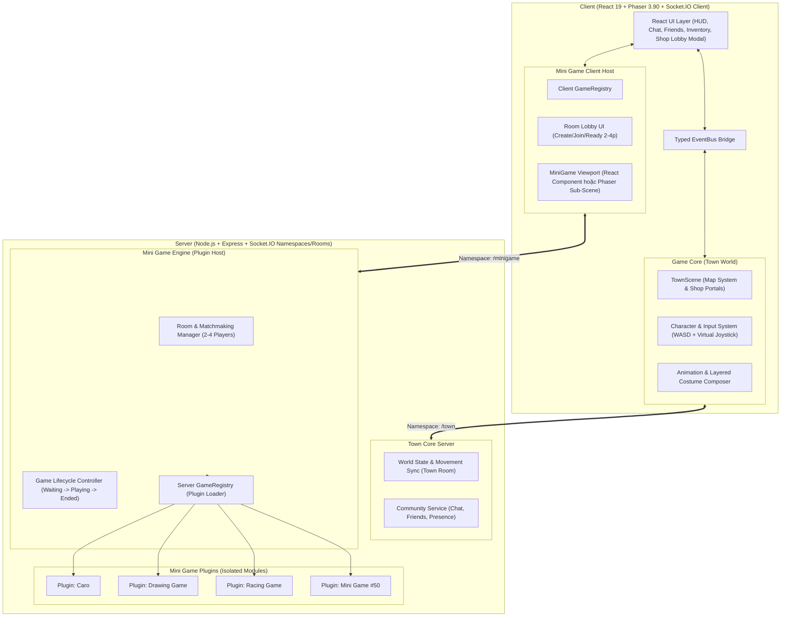
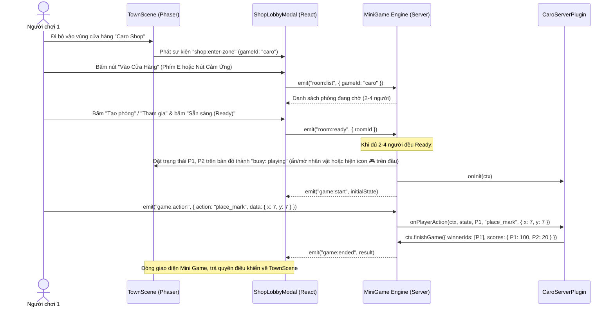

# Kiến Trúc Kỹ Thuật: MINI WORLD PARTY

> **Nguyên tắc thiết kế cốt lõi:** **Game Core hoàn toàn không biết đến logic bên trong của bất kỳ Mini Game nào.** Khi thêm trò chơi thứ 50, lập trình viên chỉ cần tạo một thư mục module mới trong `mini-games/<game-id>`, đăng ký vào `GameRegistry`, và gắn `gameId` lên một cửa hàng trên bản đồ thị trấn.

---

## 1. Sơ Đồ Kiến Trúc Tổng Thể



---

## 2. Cấu Trúc Thư Mục Chuẩn (Monorepo)

```text
MINI-WORLD-PARTY/
├── shared/                         # Các định nghĩa hằng số, kiểu dữ liệu, giao diện dùng chung
│   ├── protocol.ts                 # Danh sách tên sự kiện Socket (Town & MiniGame)
│   ├── types.ts                    # PlayerState, CostumeConfig, RoomState, MiniGameManifest
│   └── registry-manifest.ts        # Danh sách metadata các Mini Game (id, tên, số người 2-4, icon)
│
├── client/
│   └── src/
│       ├── core/                   # GAME CORE (Không phụ thuộc Mini Games)
│       │   ├── map/                # MapSystem: Tải Tiled JSON, va chạm, vùng cửa hàng (Shop Trigger Zones)
│       │   ├── character/          # CharacterSystem: Đồng bộ tọa độ, nội suy, điều khiển bàn phím + cảm ứng
│       │   ├── animation/          # AnimationSystem: Máy trạng thái (idle, walk, run, jump, sit, wave)
│       │   ├── costume/            # CostumeSystem: Offscreen Canvas ghép lớp (Body, Áo, Quần, Tóc, Phụ kiện)
│       │   └── network/            # TownSocketClient: Đồng bộ vị trí trong thị trấn
│       │
│       ├── minigame-engine/        # MINI GAME ENGINE (Client Host)
│       │   ├── GameRegistry.ts     # Đăng ký lazy-load UI/Scene của từng mini-game
│       │   ├── ShopLobbyModal.tsx  # Giao diện tạo phòng, danh sách phòng, nút Sẵn sàng (Ready)
│       │   └── MiniGameContainer.tsx # Khung chạy mini-game độc lập, tự dọn dẹp khi thoát về thị trấn
│       │
│       ├── mini-games/             # CÁC MODULE MINI GAME ĐỘC LẬP
│       │   ├── caro/               # CaroClientModule.tsx
│       │   ├── drawing/            # DrawingClientModule.tsx
│       │   └── racing/             # RacingClientScene.ts
│       │
│       └── community/              # COMMUNITY MODULES
│           ├── chat/               # Chat toàn thị trấn, chat gần, chat trong phòng chờ
│           ├── friends/            # Danh sách bạn bè & dịch chuyển tới bạn bè
│           ├── inventory/          # Tủ đồ thay trang phục thời gian thực
│           └── leaderboard/        # Bảng xếp hạng điểm thưởng từ mini-games
│
└── server/
    └── src/
        ├── core/                   # GAME CORE SERVER
        │   ├── TownInstance.ts     # Quản lý người chơi trên bản đồ, kiểm tra va chạm, trạng thái bận chơi game
        │   └── CommunityServer.ts  # Xử lý Chat, Friends, Inventory, Leaderboard
        │
        ├── minigame-engine/        # MINI GAME ENGINE SERVER
        │   ├── GameRegistry.ts     # Đăng ký Server Plugin của từng mini-game
        │   ├── RoomManager.ts      # Tạo phòng, ghép phòng (Matchmaking), quản lý Ready 2-4 người
        │   └── GameRoomSession.ts  # Vòng đời ván chơi, cô lập lỗi (Error Boundary), phát thưởng khi kết thúc
        │
        └── mini-games/             # LOGIC SERVER CỦA TỪNG MINI GAME
            ├── caro/               # CaroServerPlugin.ts
            ├── drawing/            # DrawingServerPlugin.ts
            └── racing/             # RacingServerPlugin.ts
```

---

## 3. Thiết Kế Kiến Trúc Plugin Cho Mini Game (`Mini Game Engine`)

### 3.1. Chuẩn Giao Tiếp Plugin (Plugin Contract)
Mọi mini-game chỉ cần hiện thực hóa đúng 2 giao diện (Server & Client) mà không cần đụng vào Socket.IO tổng:

```typescript
// shared/types.ts
export interface MiniGameManifest {
  gameId: string;          // VD: "caro", "drawing", "racing"
  title: string;           // VD: "Cờ Caro Tốc Độ"
  minPlayers: number;      // Mặc định: 2
  maxPlayers: number;      // Mặc định: 4
  shopTileZone: string;    // Tên vùng cửa hàng trên bản đồ Tiled
}

// server/src/minigame-engine/types.ts
export interface IMiniGameContext {
  roomId: string;
  players: Array<{ id: string; name: string; costume: CostumeConfig }>;
  /** Gửi sự kiện tới toàn bộ người chơi trong phòng mini-game này */
  broadcast(event: string, payload: unknown): void;
  /** Gửi sự kiện riêng cho 1 người chơi (VD: từ khóa bí mật trong game Vẽ hình) */
  sendTo(playerId: string, event: string, payload: unknown): void;
  /** Kết thúc ván chơi và trả kết quả về Mini Game Engine */
  finishGame(result: { winnerIds: string[]; scores: Record<string, number> }): void;
}

export interface IMiniGameServerPlugin<TState = unknown> {
  manifest: MiniGameManifest;
  onInit(ctx: IMiniGameContext): TState;
  onPlayerAction(ctx: IMiniGameContext, state: TState, playerId: string, action: string, data: unknown): void;
  onPlayerLeave(ctx: IMiniGameContext, state: TState, playerId: string): void;
  onTick?(ctx: IMiniGameContext, state: TState, dtMs: number): void; // Dùng cho game real-time như Racing
  onDispose?(state: TState): void;
}
```

### 3.2. Luồng Hoạt Động Từ Cửa Hàng Vào Mini Game (Shop -> Lobby -> Match -> Town)



> [!TIP]
> **Tối ưu hiệu năng khi đang chơi Mini Game:** Khi người chơi vào trận (`Playing`), `TownScene` bên dưới tự động chuyển sang chế độ tiết kiệm tài nguyên (tạm khóa nhận input di chuyển thị trấn và hiển thị biểu tượng `🎮 Đang chơi` trên đầu nhân vật ở bản đồ ngoài để bạn bè trong thị trấn biết họ đang ở trong cửa hàng nào).

---

## 4. Kiến Trúc Nhân Vật Chibi 2D, Hệ Thống Trang Phục Theo Lớp & Animation

### 4.1. Yêu Cầu Thiết Kế Nhân Vật Chibi 2D
* **Phong cách:** Chibi 2D tối giản, đầu to thân nhỏ tỉ lệ 1:1.5, đường viền (outline) mượt và sắc nét.
* **Kích thước khung hình chuẩn (Frame Size):** `64x64 px` (hiển thị sắc nét trên màn hình Retina/High-DPI, rộng rãi cho hiệu ứng nhảy cao và vẫy tay mà không bị cắt khung như ô `32x32 px` cũ).
* **6 Trạng thái Hoạt ảnh (Animations) bắt buộc:**
  1. `idle` (Đứng thở nhẹ nhàng — 4 frame, lặp)
  2. `walk` (Đi bộ bình thường — 6 frame, lặp)
  3. `run` (Chạy lon ton nhanh, người hơi nghiêng — 6 frame, lặp)
  4. `jump` (Nhảy lên cao kèm bóng đổ thu nhỏ dưới chân — 4 frame, chạy 1 lần)
  5. `sit` (Ngồi xuống ghế/thảm quảng trường — 2 frame, giữ trạng thái)
  6. `wave` (Đứng vẫy tay chào bạn bè — 4 frame, chạy 1 lần hoặc lặp)

### 4.2. Kiến Trúc Ghép Lớp Trang Phục (Data-Driven Layered Costume System)
Để **thêm trang phục và animation mới mà không phải sửa bất kỳ dòng code logic nhân vật nào**, hệ thống tách hoàn toàn **Dữ liệu Cấu hình (`costume-manifest.json` & `animation-manifest.json`)** khỏi **Bộ kết xuất (`CostumeComposer.ts`)**:

1. **Thứ tự xếp lớp chuẩn (`Z-Order Layers` từ dưới lên trên):**
   ```text
   [0] shadow        (Bóng đổ elip bán trong suốt dưới chân - Phaser quản lý)
   [1] back_item     (Áo choàng / Cánh / Balo đeo lưng)
   [2] body          (Cơ thể Chibi gốc + màu da + mắt/biểu cảm)
   [3] shoes         (Giày / Dép)
   [4] bottom        (Quần / Chân váy)
   [5] top           (Áo / Áo khoác)
   [6] hair          (Tóc trước & sau)
   [7] face_acc      (Kính mắt / Mặt nạ / Má hồng)
   [8] hat           (Mũ / Tai thú / Vương miện)
   ```

2. **Quy trình Ghép Atlas Một Lần (`Single-Pass Offscreen Canvas Baking`):**
   * Thay vì tạo 8 `Phaser.GameObjects.Sprite` con cho mỗi người chơi (nếu có 30 người trong quảng trường sẽ tốn `30 × 8 = 240` sprites phải đồng bộ frame mỗi tích tắc), ta nâng cấp kỹ thuật `composeAvatarSpriteSheetCanvas` từ `TheGathering`:
   * Khi người chơi xuất hiện hoặc đổi đồ trong Tủ đồ, `CostumeComposer` tải các tấm ảnh PNG layer tương ứng (đều có cùng bố cục lưới dòng/cột theo `animation-manifest.json`), vẽ chồng lên một `OffscreenCanvas` duy nhất, có hỗ trợ nhuộm màu (`tintColor` qua `globalCompositeOperation`), và đăng ký vào Phaser với khóa định danh theo hash cấu hình: `costume_${hash(costumeConfig)}`.
   * Nếu 2 người chơi mặc bộ đồ giống nhau, họ dùng chung 1 texture trong bộ nhớ GPU!

3. **Thêm Animation hoặc Trang phục mới không chạm vào Code:**
   * **Thêm Trang phục mới:** Chỉ cần thả file ảnh PNG chuẩn lưới vào `/assets/costumes/<layer>/<item_id>.png` và khai báo 1 dòng JSON trong `costume-manifest.json`. Giao diện Tủ đồ (`Inventory`) và `CostumeComposer` tự động đọc JSON để hiển thị và ghép lớp.
   * **Thêm Animation mới (VD: `dance`):** Chỉ cần thêm định nghĩa dòng (row) và số frame vào `animation-manifest.json`:
     ```json
     {
       "id": "dance",
       "row": 6,
       "frames": 8,
       "frameRate": 10,
       "repeat": -1,
       "directional": false
     }
     ```
     `AnimationSystem` sẽ tự động đọc danh sách này khi khởi tạo để đăng ký mọi animation với Phaser và tạo nút bấm tương ứng trên thanh Action Bar!

---

## 5. Thiết Kế Hỗ Trợ Đa Thiết Bị (Desktop + Mobile Touch)

Khắc phục triệt để nhược điểm không đi lại được trên điện thoại của cả hai repo gốc:
* **Unified Input Controller (`InputController.ts`):**
  * Trả về một vector chuẩn hóa `{ vx, vy, isRunning, actionTriggered }` ở mỗi frame cho `CharacterSystem`, bất kể đầu vào đến từ đâu:
    * **Desktop:** `WASD` / Phím mũi tên + giữ `Shift` để chạy lon ton (`run`), phím `Space` để nhảy (`jump`), phím `E` để vào cửa hàng.
    * **Mobile / Tablet:**
      * **Cần gạt ảo (Virtual Analog Joystick)** ở góc dưới bên trái: kéo nhẹ (< 60% bán kính) nhân vật đi bộ (`walk`), kéo sát viền (> 60% bán kính) nhân vật tự động chuyển sang chạy lon ton (`run`)!
      * **Cụm nút hành động cảm ứng (Touch Action Cluster)** ở góc dưới bên phải: Nút `Nhảy (Jump)`, nút `Vẫy tay/Ngồi (Emote)` và nút ngữ cảnh **`Vào Cửa Hàng`** (chỉ sáng lên khi nhân vật bước vào vùng `Shop Trigger Zone`).
      * **Chụm 2 ngón tay (Pinch-to-Zoom):** Hỗ trợ phóng to/thu nhỏ camera mượt mà trên màn hình cảm ứng bên cạnh con lăn chuột.
